# 1 · Conceptos básicos de computación cuántica

> **Objetivo de la unidad:** entender qué es un qubit y las propiedades cuánticas (superposición, medición, interferencia, entrelazamiento, decoherencia y efecto túnel) que usan los ordenadores cuánticos. No hace falta saber física: buscamos la **idea** y su utilidad en informática.

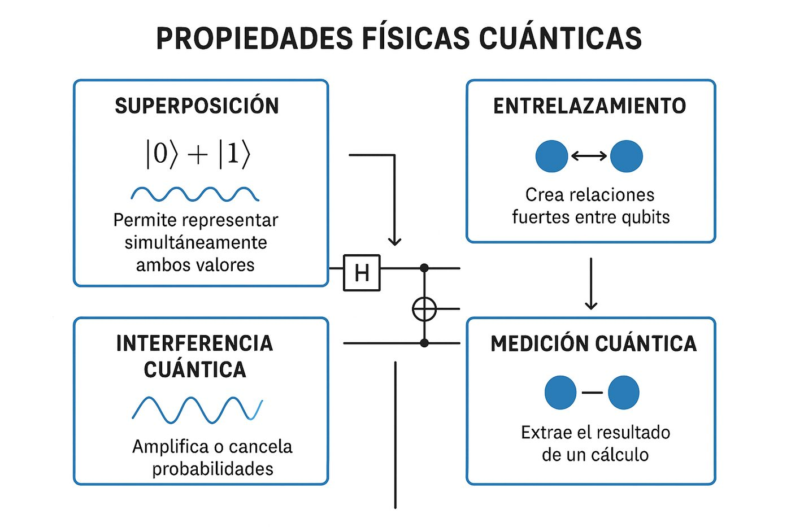

---

## 1.1 ¿Qué es la computación cuántica?

La computación cuántica es un **paradigma de computación distinto** al de la informática clásica:

| Ordenador clásico (PC, móvil, servidor) | Ordenador cuántico |
|---|---|
| Unidad mínima: **bit** → vale 0 **o** 1 | Unidad mínima: **qubit** → puede ser 0, 1 **o una combinación de ambos** |
| Procesa paso a paso con puertas lógicas | Aprovecha leyes de la mecánica cuántica |
| Sirve para casi todo | Sirve para **ciertos problemas** muy concretos |

Su ventaja **no** es ser "más rápido en todo". Es que, para algunos problemas (optimización, simulación química, criptografía…), puede encontrar la solución de una forma a la que un ordenador clásico no tiene acceso, y que a este le llevaría muchísimo tiempo.

> 🎬 Vídeo recomendado: [FÍSICA CUÁNTICA: los conceptos básicos en 25 minutos](https://youtu.be/bkUjjTwluQI)

## 1.2 Mecánica cuántica en una frase

La **mecánica cuántica** describe cómo se comporta la materia a escala muy pequeña (átomos, electrones, fotones). A esa escala las partículas no se comportan como "bolitas" con una posición fija, sino como **ondas de probabilidad**. Los ordenadores cuánticos sustituyen los circuitos de bits por partículas cuánticas (**qubits**) para aprovechar ese comportamiento.

Principios clave que veremos:

1. Qubit
2. Superposición
3. Medición (colapso)
4. Interferencia
5. Entrelazamiento
6. Decoherencia
7. Efecto túnel

---

## 1.3 El qubit

| 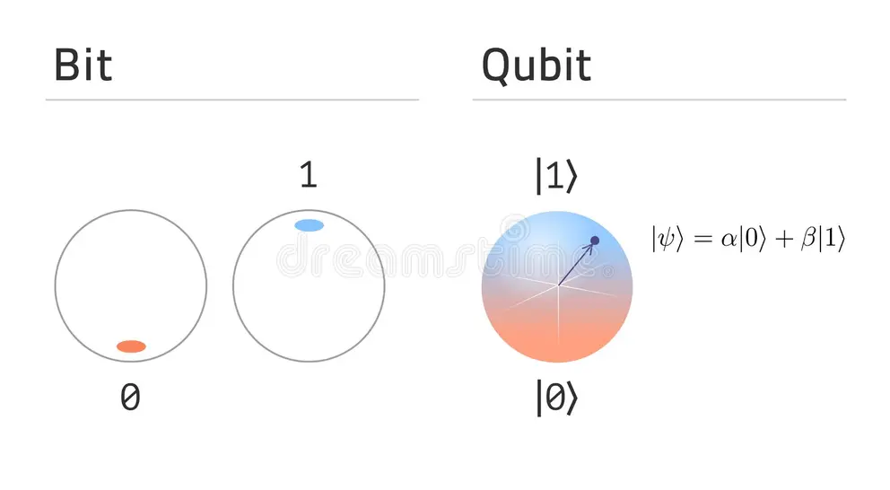 |
|---|
| *Un bit está en 0 o en 1. Un qubit puede estar en cualquier punto de la esfera: una mezcla de 0 y 1.* |

- Un **bit clásico** es como un **interruptor**: apagado (0) o encendido (1).
- Un **qubit** puede comportarse como un bit, pero también puede ser una **combinación ponderada de 0 y 1 a la vez**.

Matemáticamente:

```
|ψ⟩ = α|0⟩ + β|1⟩ con |α|² + |β|² = 1
```

- α y β se llaman **amplitudes de probabilidad**.
- |α|² = probabilidad de obtener **0** al medir.
- |β|² = probabilidad de obtener **1** al medir.
- La suma vale 1 (100 %): al medir **siempre** sale 0 o 1, nunca "nada".

**Ejemplo:** si |α|² = 0,7 y |β|² = 0,3, al medir 100 qubits preparados igual saldrán ≈70 ceros y ≈30 unos.

### Hardware real
Mantener un qubit en superposición es muy difícil: hay que **aislarlo** casi por completo y **enfriarlo cerca del cero absoluto (−273 °C)**. Eso exige grandes criostatos y mucha energía.

| 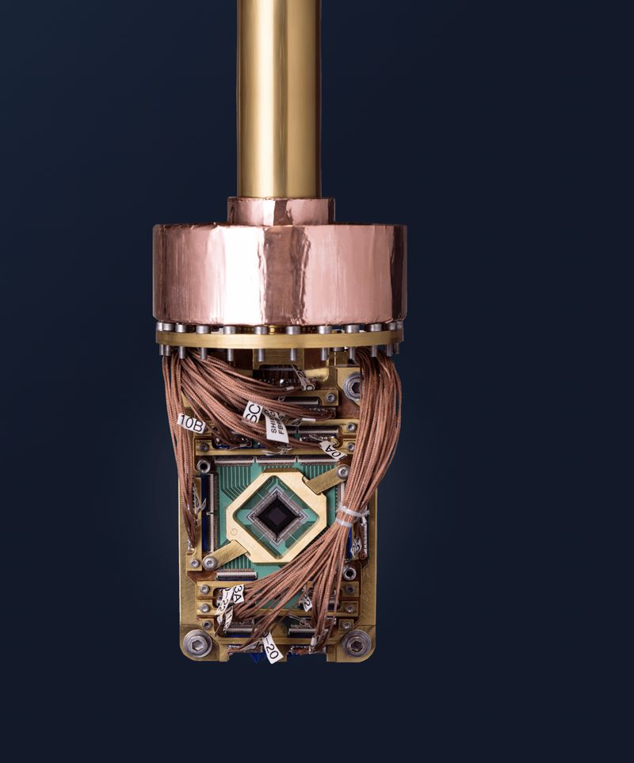 | 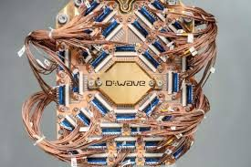 |
|---|---|
| *Criostato con el procesador cuántico en la parte inferior* | *Chip de un annealer cuántico D-Wave (Fuente: D-Wave)* |

---

## 1.4 La esfera de Bloch

Es la forma "visual" de representar un qubit: una **esfera de radio 1**.

- **Polo norte** = estado |0⟩
- **Polo sur** = estado |1⟩
- **Cualquier otro punto de la superficie** = una superposición.
- Los puntos **del interior** representan estados "estropeados" por el ruido (decoherencia).

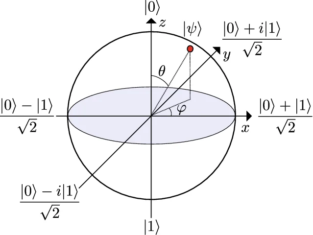

🧪 **Simulador interactivo:** [Grok the Bloch Sphere](https://javafxpert.github.io/grok-bloch/) — mueve el vector y observa las probabilidades.

---

## 1.5 Superposición

> Un qubit puede estar en una combinación de |0⟩ y |1⟩ **al mismo tiempo**, con ciertas probabilidades.

### Una analogía física: el electrón
El modelo atómico antiguo (Bohr) dibujaba electrones girando en órbitas como planetas. La mecánica cuántica lo descarta: el electrón **no está en un punto concreto**, sino "repartido" en una **nube de probabilidad** (orbital). Solo cuando **medimos** aparece en un lugar concreto.

| 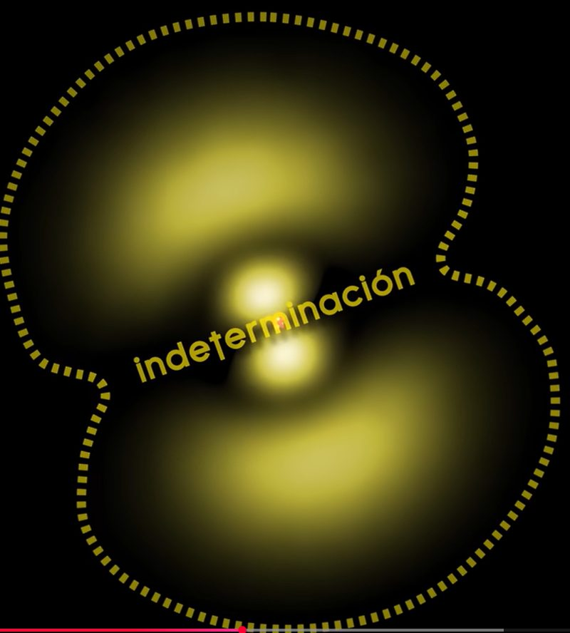 | 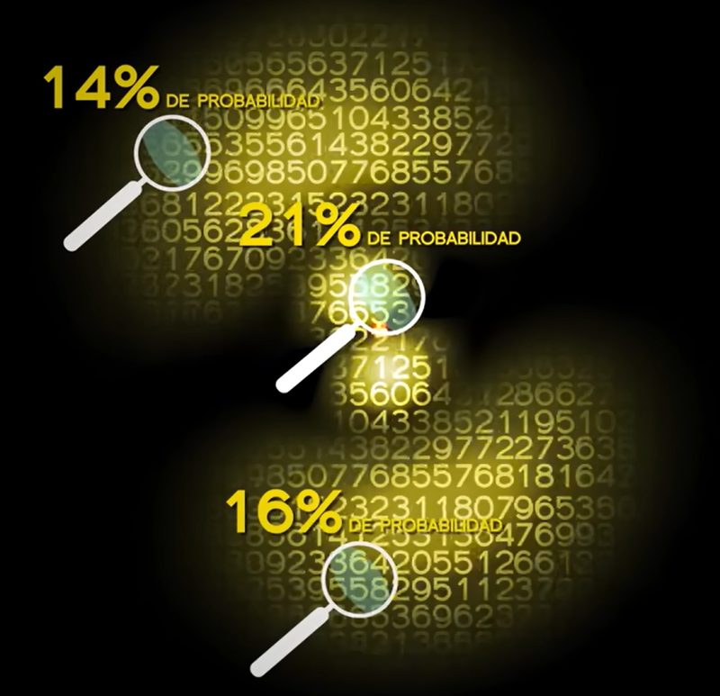 | 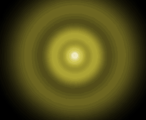 |
|---|---|---|

*Fuente: [Quantum Fracture (YouTube)](https://www.youtube.com/@QuantumFracture)*

### Con varios qubits: crecimiento exponencial

**3 bits clásicos** pueden guardar 8 combinaciones (000, 001, …, 111) pero **solo una cada vez**. Para pasar de 101 a 111 hay que cambiar bits uno a uno.

**3 qubits** pueden estar en superposición de **las 8 combinaciones a la vez**:

```
|ψ⟩ = α₀|000⟩ + α₁|001⟩ + … + α₇|111⟩
```

- |ψ⟩ ("ket psi") = estado total del sistema.
- |000⟩, |001⟩… = los 8 estados clásicos posibles.
- α₀, α₁… = amplitudes; la suma de sus cuadrados es 1.

**Con n qubits se representan 2ⁿ estados simultáneos.**

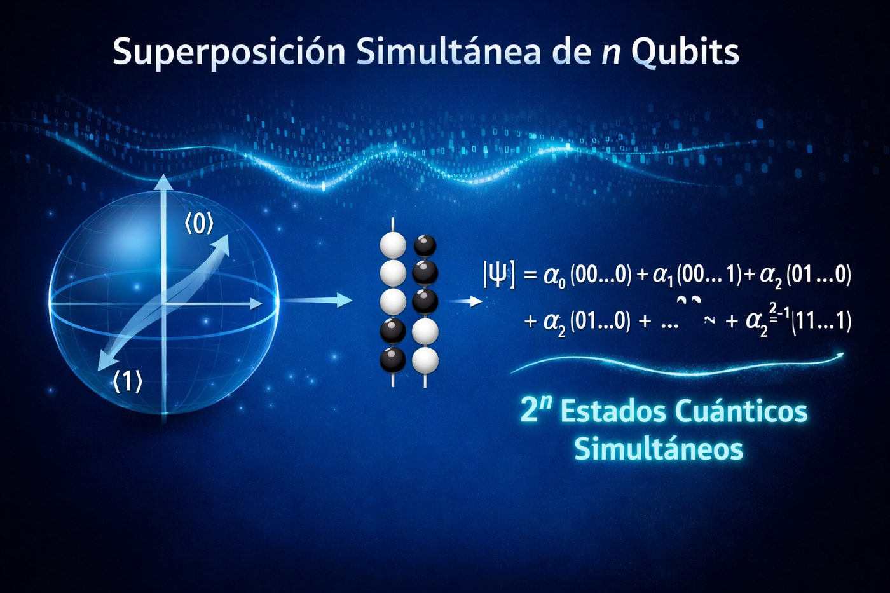

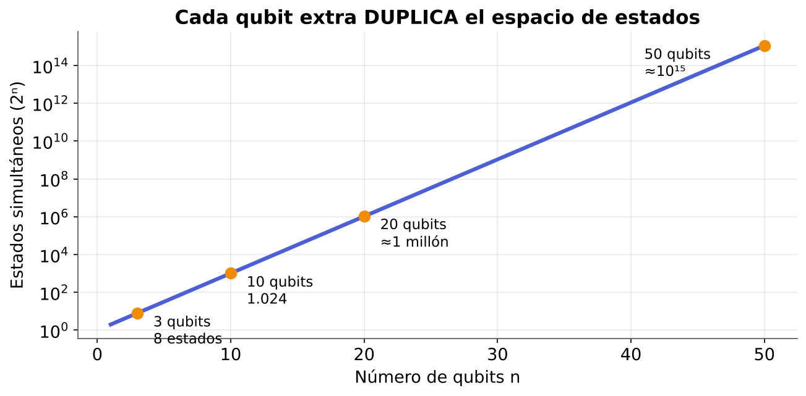

| Qubits | Estados simultáneos |
|---:|---:|
| 1 | 2 |
| 3 | 8 |
| 10 | 1.024 |
| 20 | ≈ 1 millón |
| 50 | ≈ 10¹⁵ (mil billones) |
| 100 | ≈ 10³⁰ (más que estrellas en el universo observable) |

---

## 1.6 Medición y colapso

Al **medir** un qubit, su superposición **colapsa** a un valor clásico: 0 (con probabilidad |α|²) o 1 (con probabilidad |β|²).

- Mientras **no medimos**, el estado evoluciona de forma ordenada (*unitaria y coherente*) y podemos "moldearlo" con campos electromagnéticos (microondas, láseres…).
- Al medir obtenemos **un único resultado**. Por eso los algoritmos cuánticos se diseñan para que la respuesta correcta sea **la más probable** en el momento de medir.

> ⚠️ Idea errónea frecuente: "el ordenador cuántico prueba todas las soluciones y las lee todas a la vez". **Falso:** solo leemos una. El truco está en la interferencia.

---

## 1.7 Interferencia cuántica

La superposición **sola no basta**. La verdadera ventaja aparece cuando el algoritmo usa **interferencia** para cambiar las probabilidades antes de medir:

- **Interferencia constructiva:** las amplitudes de la respuesta correcta se **suman** → aumenta su probabilidad.
- **Interferencia destructiva:** las amplitudes de las respuestas incorrectas se **cancelan** → su probabilidad baja casi a cero.

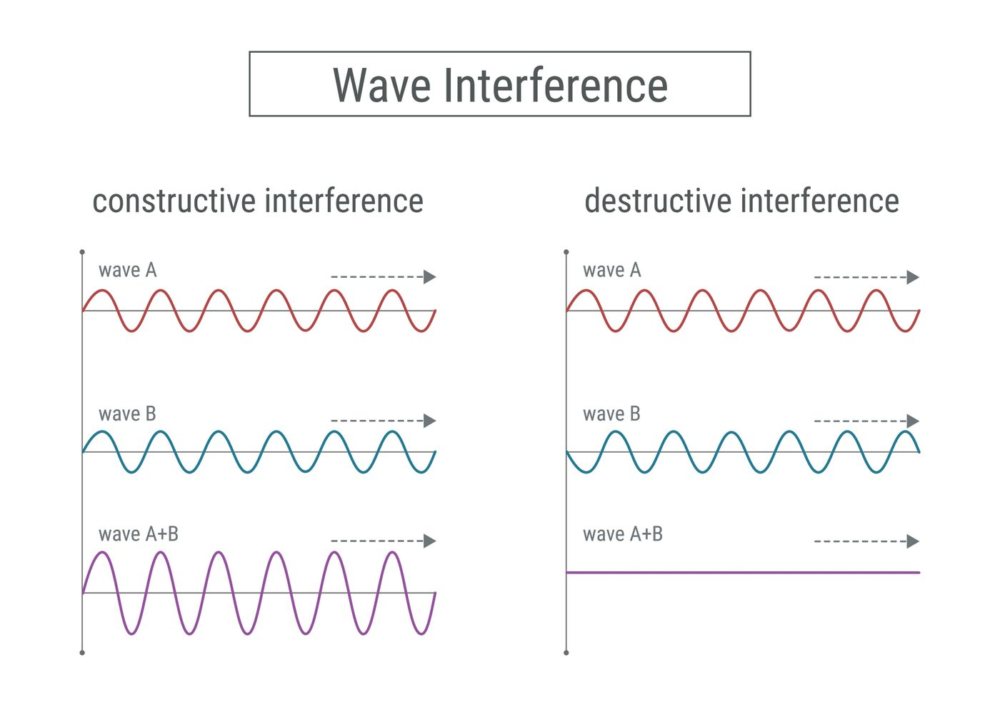

**Analogía de las olas en un estanque:** cada estado posible es un punto del agua. Si en un punto las ondas llegan "pico con valle", se anulan (incorrecto). Si llegan "pico con pico", se refuerzan (correcto).

**Analogía de los exploradores:** 1.000 exploradores (qubits en superposición) salen a la vez por todo el terreno. Cuando están en valles poco profundos sus señales de radio se cancelan; cuando encuentran el valle más profundo, se suman y atraen a los demás. Al final casi todos están en el valle más profundo: esa es la respuesta que medimos.

### Algoritmos famosos que usan interferencia
| Algoritmo | Qué hace | Ventaja |
|---|---|---|
| **Shor** | Factoriza números enormes en primos | Exponencial. Rompería RSA… cuando existan ordenadores cuánticos mucho mayores que los actuales |
| **Grover** | Busca un dato en una lista desordenada | Cuadrática: √N pasos en vez de N (1.000.000 datos → ~1.000 pasos) |

---

## 1.8 Entrelazamiento

Es una **correlación cuántica** entre qubits: el estado de uno queda ligado al del otro, **aunque estén lejos**. Si medimos uno, sabemos al instante qué vale el otro.

| 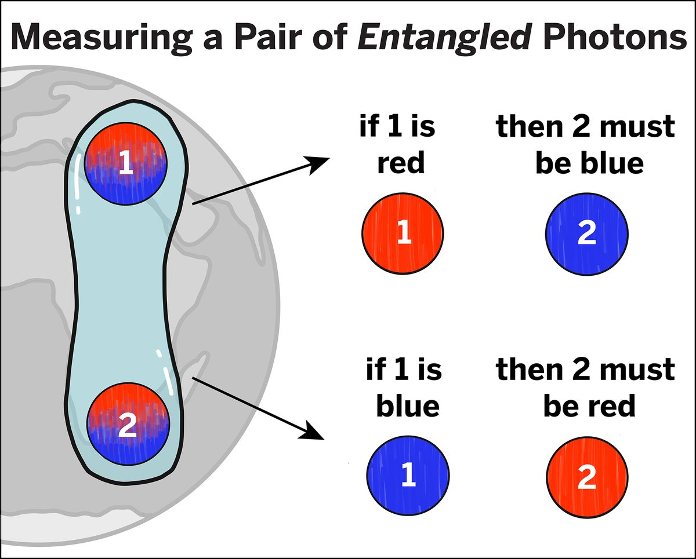 | 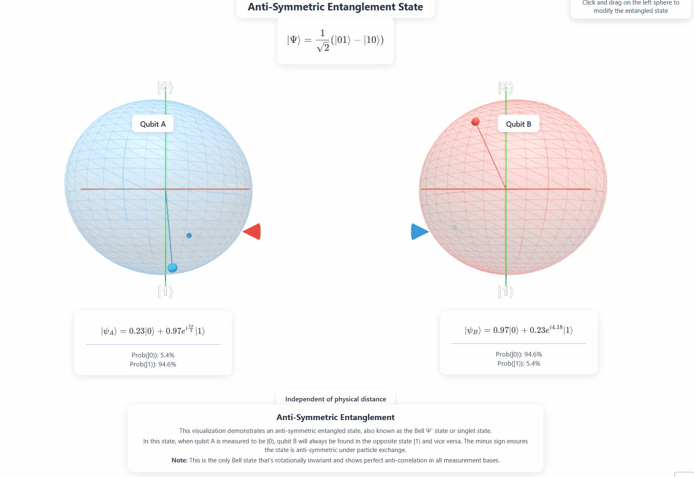 |
|---|---|
| *Si el fotón 1 es rojo, el 2 es azul (y viceversa)* | *Simulación interactiva de dos qubits entrelazados* |

🧪 Animación interactiva: <https://entanglementqbits.netlify.app/>

Para qué sirve:
- Crear relaciones fuertes entre qubits (imprescindible en Shor y Grover).
- Teleportación cuántica y comunicaciones seguras.

---

## 1.9 Decoherencia

Es la **pérdida del comportamiento cuántico**: el qubit deja de estar en superposición y se convierte en un bit clásico.

- Puede provocarse **a propósito** (al medir).
- O **por accidente**: calor, vibraciones, radiación, campos electromagnéticos…

Los estados cuánticos son **extremadamente frágiles**. La lucha contra la decoherencia (aislamiento, frío extremo, **corrección de errores**) es el gran reto para construir ordenadores cuánticos útiles.

---

## 1.10 Efecto túnel cuántico

Una partícula cuántica puede **atravesar una barrera de energía** que, clásicamente, no podría superar. Es como aparecer al otro lado de una montaña **sin escalarla**.

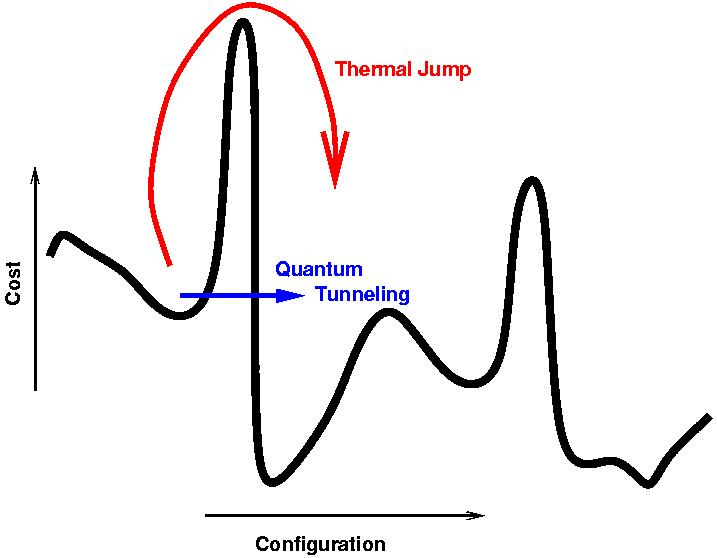

*Fuente: Wikipedia*

En **optimización** imaginamos las soluciones como un **paisaje de montañas y valles** (energía = coste). El efecto túnel ayuda a escapar de un **valle poco profundo (mínimo local)** para llegar al **valle más profundo (mínimo global)**. Es la base del **Quantum Annealing** (unidad 3).

---

## 1.11 ¿Cómo "piensa" un ordenador cuántico? La analogía del laberinto

- **Ordenador clásico:** prueba los caminos uno a uno (fuerza bruta) y recuerda los callejones sin salida.
- **Ordenador cuántico:** no prueba todos los caminos a la vez. Trabaja con **amplitudes** que, como ondas, se superponen e interfieren: los caminos malos se cancelan y el bueno se refuerza, como si tuviera "vista de pájaro" del laberinto.

> Otra imagen: en vez de recorrer el laberinto pasillo a pasillo, **lo inundas de agua**: el flujo encuentra la salida de forma natural.

---

## ✅ Resumen de la unidad

| Propiedad | En una frase | ¿Para qué sirve? |
|---|---|---|
| **Qubit** | 0, 1 o mezcla de ambos | Unidad de información cuántica |
| **Superposición** | n qubits → 2ⁿ estados a la vez | Explorar muchas soluciones |
| **Medición** | Colapsa a 0 o 1 con cierta probabilidad | Obtener el resultado |
| **Interferencia** | Sumar lo correcto, cancelar lo incorrecto | Que la buena respuesta sea la más probable |
| **Entrelazamiento** | Qubits correlacionados | Algoritmos potentes, comunicaciones seguras |
| **Decoherencia** | Pérdida de lo cuántico por ruido | El enemigo a combatir |
| **Efecto túnel** | Atravesar barreras de energía | Escapar de mínimos locales (annealing) |

### Preguntas de repaso
1. ¿Cuántos estados representa un sistema de 8 qubits en superposición?
2. Si |α|² = 0,25, ¿qué probabilidad hay de medir 1?
3. ¿Por qué decimos que la superposición "no basta" para tener ventaja cuántica?
4. ¿Qué relación tiene el efecto túnel con los problemas de optimización?

<details><summary>Soluciones</summary>

1. 2⁸ = 256 estados. 2. 0,75 (75 %). 3. Porque al medir solo leemos un resultado; hace falta interferencia para que ese resultado sea el correcto. 4. Permite pasar de un mínimo local a otro mejor sin "subir" la barrera de energía.
</details>
