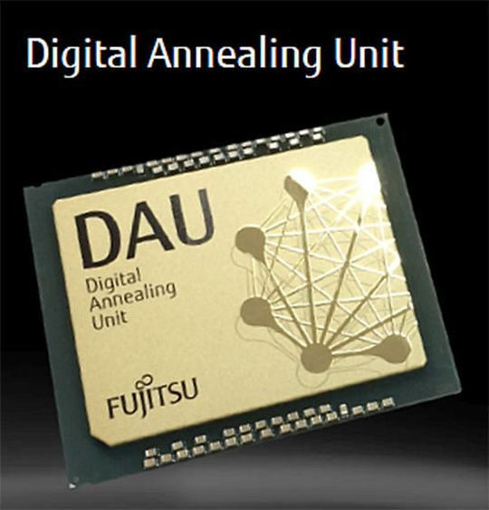
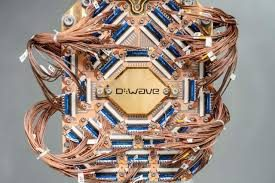
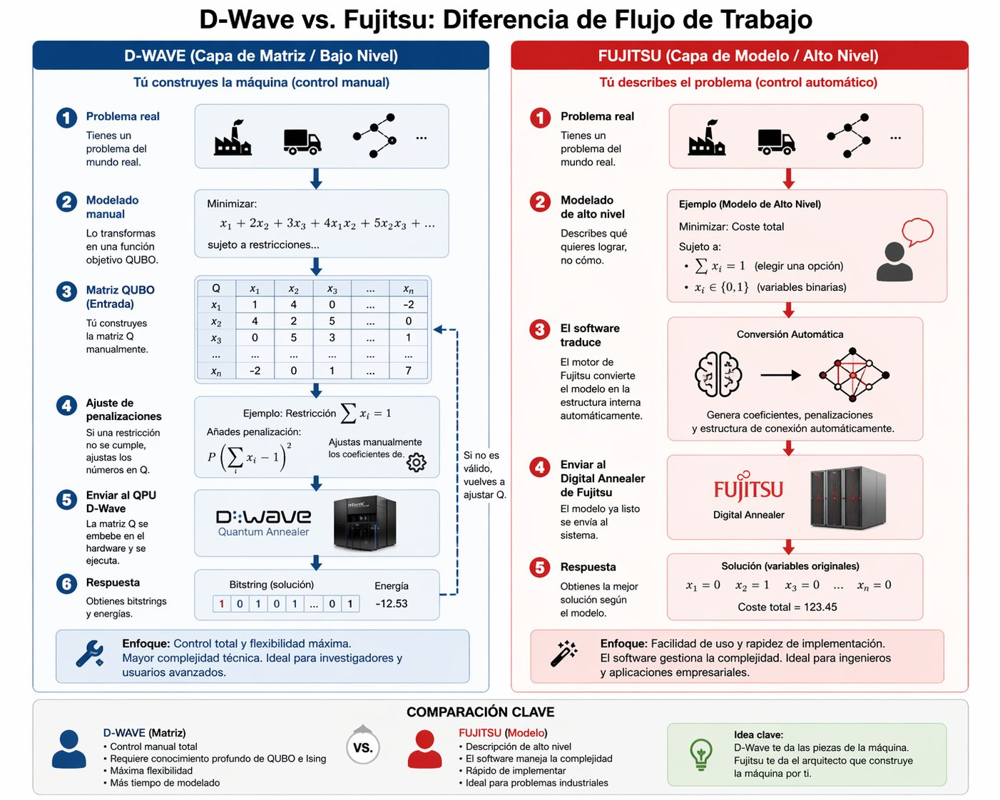

# 2 · Hardware cuántico y estado actual

> **Objetivo de la unidad:** conocer los tipos de qubits, los dos grandes modelos de ordenador cuántico (**puertas lógicas** y **annealing**), los fabricantes principales y en qué punto real está la tecnología hoy.

---

## 2.1 Tipos de qubits

Los qubits se fabrican con sistemas físicos que muestran comportamiento cuántico. Cada tecnología tiene ventajas e inconvenientes:

| Tipo | Cómo es | ✅ Ventaja | ❌ Inconveniente | Quién lo usa |
|---|---|---|---|---|
| **Superconductores** | Circuitos que conducen sin resistencia a ≈ −273 °C | Muy rápidos, control preciso | Necesitan criostatos enormes | IBM, Google, Rigetti, D-Wave |
| **Iones atrapados** | Átomos cargados sujetos con campos y controlados con láser | Muy fiables, poco error | Más lentos | Quantinuum, IonQ |
| **Átomos neutros** | Átomos colocados con "pinzas" láser | Escalan a muchos qubits | Tecnología joven | Pasqal, QuEra |
| **Fotones** | Partículas de luz | Viajan por fibra óptica | Difíciles de hacer interactuar | Comunicación y criptografía cuántica |
| **Puntos cuánticos** | Un electrón atrapado en un semiconductor | Compatible con fábricas de chips actuales | Muy experimental | Intel y centros de investigación |

---

## 2.2 Dos modelos de ordenador cuántico

| | **Puertas lógicas (gate-based)** | **Quantum Annealing** |
|---|---|---|
| Idea | "Ordenador cuántico universal": circuitos de puertas cuánticas | Máquina especializada en buscar el **mínimo de energía** |
| Sirve para | Cualquier algoritmo cuántico (Shor, Grover, química…) | **Optimización** (problemas QUBO / Ising) |
| Qubits hoy | Decenas o cientos de alta calidad | Miles |
| Sensibilidad al ruido | Muy alta: un error estropea el cálculo | Más robusto |
| Ejemplos | IBM, Google, Quantinuum, IonQ | **D-Wave** (cuántico) · **Fujitsu Digital Annealer** (digital, inspirado en lo cuántico) |

### ¿Por qué el annealing tiene muchos más qubits?
- **Tarea más simple:** solo busca el valle más bajo de un paisaje de energía; no tiene que ejecutar cualquier algoritmo.
- **Conectividad limitada:** cada qubit se conecta solo con unos vecinos (topologías *Pegasus* y *Zephyr* en D-Wave). Eso facilita fabricar chips grandes.
- **Más tolerante al ruido:** aunque haya algo de ruido térmico, el sistema tiende a caer hacia el mínimo de energía.

> **Resumen:** el annealing sacrifica **versatilidad** a cambio de **escala** para especializarse en resolver problemas QUBO.

---

## 2.3 Principales fabricantes (datos a finales de 2025 – 2026)

> ⚠️ Este sector cambia cada pocos meses. Las cifras son orientativas: comprueba la web del fabricante antes de usarlas.

| Proveedor | Modelo | Familia / chip | Qubits (aprox.) | Tecnología | Uso principal |
|---|---|---|---|---|---|
| **IBM** | Puertas | Heron r2 · Nighthawk · Condor | 156 · 120 · 1.121 (demo de escala) | Superconductores | I+D, algoritmos generales, química |
| **Google** | Puertas | Willow | 105 | Superconductores | Investigación, corrección de errores |
| **Quantinuum** | Puertas | Helios (antes H2) | 98 (H2: 56) | Iones atrapados | Máxima fidelidad, qubits lógicos |
| **IonQ** | Puertas | Forte / Tempo | 36 – 64 (#AQ) | Iones atrapados | Aplicaciones comerciales, ML cuántico |
| **Rigetti** | Puertas | Ankaa-3 / Cepheus | 84 – 108 | Superconductores | I+D, algoritmos híbridos |
| **Pasqal** | Puertas / analógico | Átomos neutros | 100 – 1.000 átomos | Átomos neutros (láser) | Simulación de materiales |
| **D-Wave** | **Annealing** | Advantage · **Advantage2** | 5.000+ · 4.400+ | Superconductores | Optimización: logística, finanzas |
| **Fujitsu** | **Digital Annealer** | DA (4ª generación) | Hasta 100.000 bits *digitales* | CMOS (no cuántico) | Optimización masiva |

**Datos a destacar**

- **D-Wave Advantage2** (disponible desde mayo de 2025): más de 4.400 qubits y topología *Zephyr*, en la que **cada qubit se conecta con 20** (antes 15). Se usa a través del servicio en la nube **Leap**.
- **Fujitsu Digital Annealer**: no usa qubits sino **circuitos digitales** que imitan el annealing. Funciona **a temperatura ambiente** y todas sus variables están conectadas entre sí (**all-to-all**).
- **IBM en Euskadi:** en octubre de 2025 se inauguró en Donostia el **IBM Quantum System Two** del *IBM-Euskadi Quantum Computational Center*, con procesador **Heron de 156 qubits**; el primero de este tipo en Europa.

|  |  |
|---|---|
| *Digital Annealing Unit de Fujitsu (Fuente: Fujitsu)* | *Procesador de D-Wave (Fuente: D-Wave)* |

---

## 2.4 Era NISQ: el estado real de la tecnología

Los ordenadores de puertas actuales pertenecen a la era **NISQ** (*Noisy Intermediate-Scale Quantum* = cuántico ruidoso de escala intermedia):

- **Ruido:** los qubits pierden su información muy rápido (decoherencia).
- **Escala:** 100–150 qubits es mucho, pero para romper claves o diseñar fármacos harán falta **miles o millones** de qubits con **corrección de errores**.

### Conceptos clave
| Concepto | Significado |
|---|---|
| **Qubit físico** | El qubit real del chip, con errores |
| **Qubit lógico** | Un qubit "fiable" construido con varios qubits físicos y corrección de errores |
| **Utilidad cuántica** | El ordenador cuántico da resultados fiables en problemas que un simulador clásico de fuerza bruta no puede abordar |
| **Ventaja cuántica** | El ordenador cuántico resuelve un problema **mejor, más rápido o más barato** que cualquier método clásico conocido |

IBM prevé las primeras ventajas cuánticas verificadas hacia **finales de 2026** y un ordenador **tolerante a fallos** (IBM Quantum Starling, 200 qubits lógicos) hacia **2029**.

---

## 2.5 El modo híbrido: cómo se usa hoy

Hoy no se espera que el ordenador cuántico lo haga todo. Se **reparte el trabajo**:

```text
 ┌──────────────────────┐   matriz QUBO    ┌─────────────────────┐
 │  CPU clásica         │ ───────────────▶ │  QPU / Annealer     │
 │  · lógica y datos    │                  │  · búsqueda masiva  │
 │  · restricciones     │ ◀─────────────── │    del mínimo       │
 │  · ajusta parámetros │   soluciones     └─────────────────────┘
 └──────────────────────┘   (se repite)
```

1. **CPU clásica:** prepara los datos, las restricciones y construye el modelo.
2. **QPU / Annealer:** recibe el QUBO y busca soluciones de mínima energía.
3. **Iteración:** la CPU analiza el resultado, ajusta y vuelve a preguntar.

En los ordenadores de puertas se usan algoritmos híbridos equivalentes:
- **QAOA** (*Quantum Approximate Optimization Algorithm*): optimización (rutas, logística, finanzas). Es "el QUBO de los ordenadores de puertas".
- **VQE** (*Variational Quantum Eigensolver*): química, energía de moléculas.

### ¿Hay aplicaciones reales?
Sí, con matices:
- **Logística y flotas:** pruebas de optimización de rutas de tráfico (p. ej. Volkswagen con D-Wave).
- **Finanzas:** selección de carteras con miles de activos y restricciones de riesgo.
- **Fármacos:** plegamiento de proteínas (un problema de energía mínima).

> Muchas veces la "ventaja" no es resolver algo imposible, sino encontrar una solución **un 1–2 % mejor** o más rápido. En industrias que mueven miles de millones, ese 1 % ya compensa.

### El ordenador cuántico NO siempre es mejor
- No todos los problemas se benefician.
- Para la mayoría de tareas, un ordenador normal es más práctico y barato.
- El reto es diseñar algoritmos que aprovechen **superposición + interferencia**.

---

## 2.6 Criptografía y computación cuántica

| Concepto | Qué es |
|---|---|
| **Amenaza** | El algoritmo de **Shor** podría romper RSA y la criptografía de clave pública actual cuando existan ordenadores cuánticos grandes y tolerantes a fallos (todavía no existen). |
| **QKD** (*Quantum Key Distribution*) | Envío de claves usando fotones (protocolo **BB84**). Si alguien espía, el estado de los fotones cambia (teorema de no clonación) y se detecta. Seguridad basada en **leyes físicas**. Necesita hardware especial. |
| **PQC** (*Post-Quantum Cryptography*) | Algoritmos **clásicos** basados en problemas matemáticos que resisten a los ordenadores cuánticos (p. ej. retículos o *lattices*). **Se instala por software** en servidores y navegadores actuales. |

> 💡 Para un técnico ASIR, **PQC** es lo más cercano: ya se está desplegando en TLS, VPN y SSH.

---

## 2.7 Retos para que los ordenadores cuánticos sean útiles

1. **Más qubits por procesador** (escalar el chip).
2. **Hardware más pequeño y eficiente** (refrigeración, electrónica, consumo).
3. **Corrección de errores** (convertir qubits físicos en lógicos fiables).
4. **Nuevos algoritmos** que demuestren ventaja frente a lo clásico.
5. **Software y middleware** estable (SDK como Qiskit, Ocean, DADK).
6. **Integración con supercomputación** (HPC + QPU trabajando juntos).

---

## 2.8 Entornos de desarrollo (SDK)

| Fabricante | SDK | Modelo | Lenguaje |
|---|---|---|---|
| IBM | **Qiskit** | Puertas | Python |
| Microsoft | **Azure Quantum / QDK (Q#)** | Puertas / híbrido | Q#, Python |
| Google | **Cirq** | Puertas | Python |
| D-Wave | **Ocean SDK** (dimod, dwave-samplers, dwave-system) | Annealing / híbrido | Python |
| Fujitsu | **DADK** (Digital Annealer Development Kit) | Digital Annealer | Python |

En este módulo programamos con **D-Wave Ocean (dimod)**: es software libre, se instala con `pip` y permite escribir el modelo QUBO como una fórmula. La misma formulación serviría para el Digital Annealer de Fujitsu con su librería DADK.



---

### Fuentes
- [IBM — ¿Qué es la computación cuántica?](https://www.ibm.com/es-es/think/topics/quantum-computing)
- [D-Wave — Advantage2 disponible (mayo 2025)](https://www.businesswire.com/news/home/20250520948155/en/)
- [D-Wave — Topología Zephyr](https://support.dwavesys.com/hc/en-us/articles/32105885880087-D-Wave-s-Advantage2-Quantum-Computer-Now-Generally-Available)
- [Fujitsu — Digital Annealer](https://www.fujitsu.com/es/services/business-services/digital-annealer/what-is-digital-annealer)
- [IBM — Nighthawk (nov 2025)](https://www.constellationr.com/insights/news/ibm-launches-ibm-quantum-nighthawk-processor)
