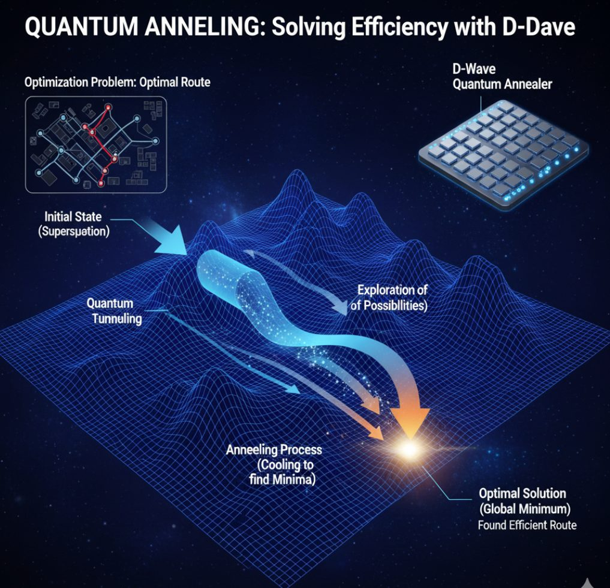
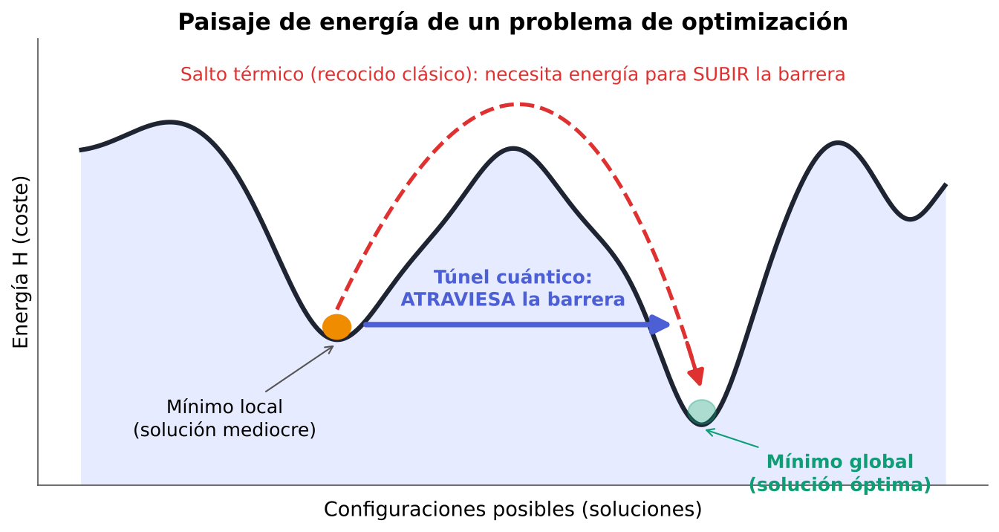
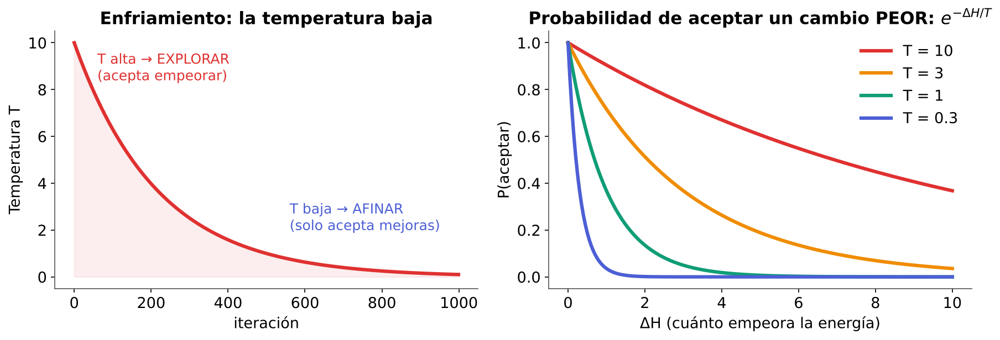
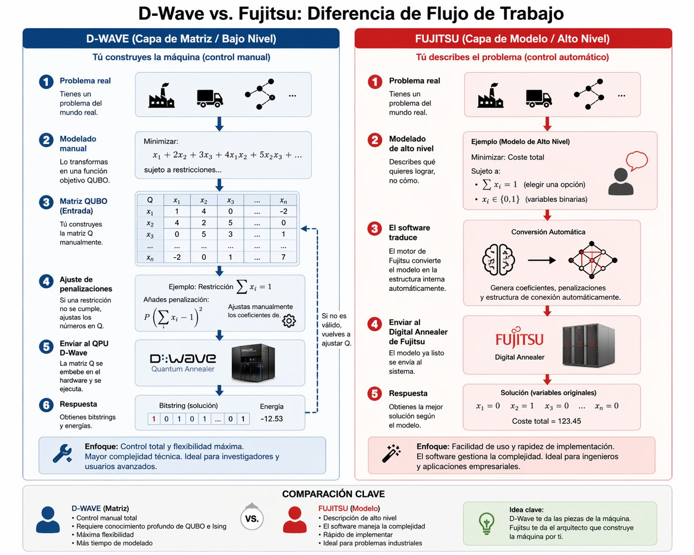

# 3 · Quantum Annealing (recocido cuántico)

> **Objetivo de la unidad:** entender cómo un *annealer* busca la mejor solución de un problema de optimización, la diferencia entre el recocido **clásico** y el **cuántico**, y qué hacen D-Wave y el Digital Annealer de Fujitsu.



*Fuente: D-Wave*

---

## 3.1 ¿De dónde viene el nombre?

**Annealing = recocido**, un proceso de **metalurgia**: se calienta un metal y se **enfría lentamente**. Así sus átomos se colocan de forma ordenada, desaparecen los defectos y el metal queda en su **estado de mínima energía** (el más estable).

En computación copiamos la idea:

> Empezar con mucha "agitación" (explorar todo) y reducirla poco a poco hasta quedarnos **en la solución de menor energía = la mejor solución**.

---

## 3.2 El paisaje de energía

Imagina un terreno lleno de **colinas y valles**:

- Cada punto del terreno es **una solución posible** (una combinación de 0 y 1).
- La altura es la **energía** = el **coste** de esa solución.
- Queremos el **punto más bajo de todo el terreno**: el **mínimo global**.



El peligro: quedarse atrapado en un **mínimo local**, un valle que parece bueno pero no es el mejor.

---

## 3.3 Clásico vs cuántico

### 🖥️ Computación clásica
- Prueba puntos **uno a uno**: empieza en un lugar y "camina" colina abajo.
- Si cae en un valle, puede quedarse **atrapado** (mínimo local).
- Para escapar usa trucos como el **recocido simulado** (*simulated annealing*): a veces acepta "subir" para saltar la colina.
- Es un proceso **secuencial**.

### ⚛️ Quantum Annealing
- El sistema empieza en **superposición**: explora todo el paisaje a la vez.
- La función de onda tiene "presencia" en cada valle.
- Gracias al **efecto túnel**, puede **atravesar montañas** en lugar de escalarlas.
- Al ir reduciendo la energía del sistema (*annealing*), la probabilidad se **concentra en los valles más profundos**.
- Al medir, **colapsa al valle más profundo con alta probabilidad**.

| Aspecto | Recocido clásico (Simulated Annealing) | Recocido cuántico (Quantum Annealing) |
|---|---|---|
| Exploración | Secuencial, aleatoria | Paralela (superposición) |
| Salir de mínimos locales | Saltos térmicos (depende de la temperatura) | Efecto túnel (atraviesa barreras) |
| Problemas grandes | Escala peor | Escala mejor en algunos casos |
| Hardware | Cualquier CPU | QPU a ≈ −273 °C (D-Wave) |

**Imagen intuitiva:**
- 🧍 *Clásico:* un caminante con linterna baja a oscuras. Si encuentra un hoyo, cree que ha llegado.
- ⚛️ *Cuántico:* una niebla que cubre todo el terreno y se "condensa" en el punto más bajo real.

> ⚠️ **No siempre es más rápido.** El annealing es eficiente en **problemas concretos** de optimización y todavía se investiga cuándo y cuánto mejora a los métodos clásicos.

---

## 3.4 Problemas que se resuelven con annealing

Son problemas de **optimización combinatoria**, muchos de tipo **NP-difícil**: el número de combinaciones **crece exponencialmente**. Ejemplo: asignar 50 tareas a 50 trabajadores tiene más de **10⁶⁴** combinaciones posibles.

| # | Problema | Definición | Aplicación real |
|---|---|---|---|
| 1 | **Mochila** (*Knapsack*) | Elegir objetos con valor y peso para maximizar el valor sin superar un límite | Inversiones, carga de contenedores |
| 2 | **Viajante** (*TSP*) | Ruta más corta que visite todas las ciudades una vez y vuelva | Rutas de reparto, brazos robóticos |
| 3 | **Asignación** | Repartir tareas entre personas/máquinas al mínimo coste | Turnos sanitarios, taxis-pasajeros |
| 4 | **Particionado de grafos** | Dividir nodos en grupos con pocas conexiones entre ellos | Redes sociales, diseño de chips |
| 5 | **Coloración de grafos** | Colorear nodos sin que dos vecinos compartan color | **Horarios de exámenes**, registros en compiladores |
| 6 | **Max-Cut** | Dividir nodos en 2 grupos cortando el máximo de aristas | Diseño de redes de comunicación |
| 7 | **Carteras** (*Portfolio*) | Mejores activos con máximo retorno y mínimo riesgo | Banca, fondos de inversión |
| 8 | **Plegamiento de proteínas** | Encontrar la forma 3D de mínima energía | Fármacos (Alzheimer, Parkinson) |

Todos ellos se pueden escribir como un **modelo QUBO** (unidad 4).

---

## 3.5 Recocido simulado: cómo funciona por dentro

El **Digital Annealer de Fujitsu** y el simulador en CPU que usaremos (`SimulatedAnnealingSampler` de D-Wave) trabajan con versiones del **recocido simulado**. El algoritmo es sencillo:

```text
1. Empezar con una combinación de bits al azar.
2. Repetir muchas veces (iteraciones):
     a. Proponer cambiar un bit (0→1 o 1→0).
     b. Calcular cuánto cambia la energía: ΔH.
     c. Si ΔH < 0 (mejora)  → ACEPTAR siempre.
        Si ΔH > 0 (empeora) → ACEPTAR con probabilidad  e^(−ΔH / T)
     d. Bajar un poco la temperatura T.
3. Devolver la mejor combinación encontrada.
```

### El papel de la temperatura T



| T | Comportamiento | Fase |
|---|---|---|
| **Alta** | Acepta con facilidad soluciones peores → puede **salir de valles** | **Exploración** |
| **Baja** | Casi solo acepta mejoras → **afina** la solución | **Explotación** |

> En los solvers que usaremos la temperatura **se gestiona automáticamente** (*schedule* de enfriamiento). El usuario controla sobre todo las **iteraciones** (`num_sweeps`) y los **runs** (`num_reads`).

### Iteraciones y runs
| Parámetro | Qué es | Efecto |
|---|---|---|
| **Iteraciones** (`num_sweeps`) | Pasos de búsqueda dentro de una ejecución | Más iteraciones = enfriamiento más lento y cuidadoso |
| **Runs** (`num_reads`) | Ejecuciones independientes, cada una desde un punto al azar | Más runs = más probabilidad de encontrar el mínimo global |
| **Frecuencia** | En cuántos runs se llegó a la misma solución | Alta frecuencia = resultado fiable |

Como el método es **probabilístico**, una sola ejecución puede no dar la mejor solución. Por eso se lanzan varios *runs*.

---

## 3.6 D-Wave vs Fujitsu Digital Annealer

| | **D-Wave** (Quantum Annealing) | **Fujitsu** (Digital Annealer) |
|---|---|---|
| Hardware | Qubits superconductores reales | Circuitos digitales CMOS (+ servidores HPC/GPU) |
| Temperatura | ≈ 15 milikelvin (criogenia) | Ambiente |
| Cómo escapa de mínimos locales | **Efecto túnel cuántico** | **Temperatura** y "offset" dinámico (salto térmico) |
| Conectividad | Limitada (Zephyr: 20 vecinos) → hace falta *embedding* | **All-to-all**: cualquier variable con cualquier otra |
| Tamaño útil | 4.400–5.000+ qubits físicos, pero muchos menos variables en problemas muy conectados | Hasta 100.000 variables totalmente conectadas |
| Programación | **Ocean SDK** (`dimod`): la función objetivo y las restricciones se escriben como fórmulas; la librería genera el QUBO | **DADK**: misma idea, con sus propias clases |
| Acceso | Nube **Leap** | Nube / on-premise de Fujitsu |

### Qubits físicos vs variables lógicas (*embedding*)
En un chip D-Wave **no todos los qubits están conectados con todos**. Si la variable 1 de tu problema debe interactuar con la 100 y en el chip no son vecinas, se usan **varios qubits físicos encadenados** para representar una sola variable. Esto se llama **embedding**. Por eso, de 5.000 qubits físicos, en un problema muy conectado quizá solo se aprovechan unos cientos de variables.



*Fuente: elaboración con IA (ChatGPT)*

---

## ✅ Resumen de la unidad

- **Annealing** = buscar el mínimo de energía bajando poco a poco la "agitación".
- **Paisaje de energía:** soluciones = puntos; coste = altura; objetivo = valle más profundo.
- **Clásico:** saltos térmicos controlados por la **temperatura**. **Cuántico:** **efecto túnel** + superposición.
- **Iteraciones** (duración de cada búsqueda) y **runs** (repeticiones) controlan la calidad.
- **D-Wave** = cuántico real, conectividad limitada. **Fujitsu DA** = digital, all-to-all, programación de alto nivel con DADK.

### Preguntas de repaso
1. ¿Qué representa la "altura" en el paisaje de energía?
2. Con T muy alta, ¿el algoritmo explora o afina?
3. ¿Por qué se lanzan varios *runs* del mismo problema?
4. ¿Qué es el *embedding* y por qué Fujitsu no lo necesita?

<details><summary>Soluciones</summary>

1. La energía o coste de cada solución. 2. Explora (acepta empeorar). 3. Porque el método es probabilístico; varias ejecuciones aumentan la probabilidad de encontrar el mínimo global. 4. Representar una variable con varios qubits físicos encadenados cuando el chip no tiene la conexión necesaria; Fujitsu conecta todas las variables entre sí (all-to-all).
</details>
