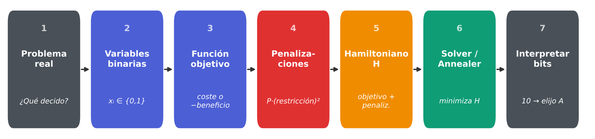
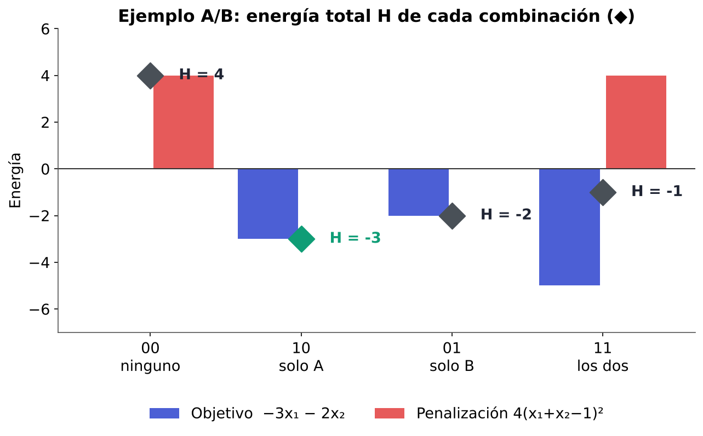
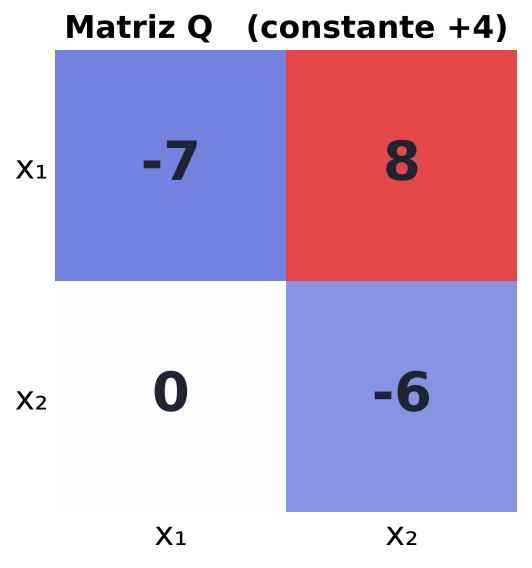
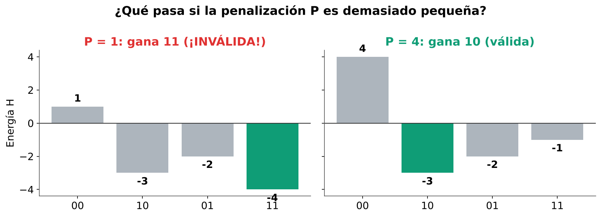

# 4 · El modelo QUBO

> **Objetivo de la unidad:** aprender a **traducir un problema real a un modelo QUBO**, que es el "idioma" que entienden D-Wave y el Digital Annealer de Fujitsu.

> *"QUBO es el puente que traduce decisiones de SÍ o NO en un paisaje de energía. El ordenador solo tiene que buscar el valle más profundo."*

---

## 4.1 ¿Qué significa QUBO?

**Q**uadratic **U**nconstrained **B**inary **O**ptimization = *Optimización Binaria Cuadrática Sin Restricciones*.

| Letra | Significado | En la práctica |
|---|---|---|
| **Q**uadratic | Cuadrática | Como mucho aparecen productos de **dos** variables: xᵢ · xⱼ |
| **U**nconstrained | Sin restricciones | Las restricciones **no se escriben aparte**: se meten en la fórmula como **penalizaciones** |
| **B**inary | Binaria | Las variables solo valen **0 o 1** |
| **O**ptimization | Optimización | Se busca el **mínimo** de la función |

Forma general:

```
H(x) = Σᵢ Qᵢᵢ xᵢ + Σ[i<j] Qᵢⱼ xᵢ xⱼ + constante
```

---

## 4.2 Vocabulario básico

| Término | Qué es |
|---|---|
| **Variable binaria** | Una decisión SÍ/NO: xᵢ ∈ {0,1} (elegido / no elegido, asignado / no asignado). |
| **Propiedad clave** | xᵢ² = xᵢ, porque 0²=0 y 1²=1. Permite simplificar fórmulas. |
| **Función objetivo** | Lo que queremos optimizar: un coste, un tiempo, una distancia… |
| **Penalización** | Término que **"castiga" con energía** las soluciones que no cumplen una restricción. |
| **P (peso de penalización)** | Número que indica **cuánto** castigamos. Debe ser suficientemente grande. |
| **Hamiltoniano H** | La **función de energía total**: objetivo + penalizaciones. Es lo que se envía al solver. |
| **Energía** | El valor de H para una combinación concreta. **Menor energía = mejor solución.** |
| **Matriz Q** | Otra forma de escribir H: la **diagonal** tiene los términos lineales y **fuera de la diagonal** los cuadráticos. |
| **Modelo Ising** | Equivalente a QUBO pero con variables {−1,+1} en vez de {0,1}. Es el "idioma físico" de D-Wave. |
| **Solver / Sampler** | Programa o máquina que busca el mínimo de H (simulador en CPU, QPU de D-Wave o Digital Annealer). |

---

## 4.3 La receta: de problema real a QUBO



> **QUBO = función objetivo + penalizaciones**

1. **Variables:** una variable binaria por cada decisión SÍ/NO.
2. **Objetivo:** escribir lo que se quiere optimizar con esas variables. **QUBO siempre minimiza**: si queremos **maximizar** un beneficio, lo ponemos **en negativo**.
3. **Penalizaciones:** cada restricción se convierte en P · (restricción)².
4. **Expandir y simplificar** usando xᵢ² = xᵢ (dimod lo hace solo).
5. **Leer la matriz Q** que genera la librería (no hace falta escribirla a mano; sirve para entender la salida).
6. **Resolver** con el solver y **comprobar** que se cumplen las restricciones.

---

## 4.4 Ejemplo resuelto paso a paso: elegir el mejor proyecto

> "Quiero elegir **exactamente uno** de dos proyectos. El proyecto **A** da un beneficio de **3** y el **B** de **2**."

La respuesta es evidente (**A**), pero nos sirve para aprender el método que luego usaremos en problemas que no se pueden resolver a mano.

| Proyecto | Beneficio |
|:---:|:---:|
| A | 3 |
| B | 2 |

### Paso 1 — Variables
- x₁ = 1 si elijo el proyecto **A** (0 si no)
- x₂ = 1 si elijo el proyecto **B** (0 si no)

### Paso 2 — Función objetivo
Beneficio total: 3x₁ + 2x₂. Como **QUBO minimiza**, cambiamos el signo:

```
H[objetivo] = −3x₁ − 2x₂
```

Así, **más beneficio = energía más baja**.

### Paso 3 — Penalización
Restricción "exactamente uno": x₁ + x₂ = 1.

La convertimos en una penalización **al cuadrado** (siempre positiva o cero):

```
H[penalización] = P (x₁ + x₂ − 1)²
```

| Caso | x₁+x₂−1 | Al cuadrado | Con P = 4 |
|---|:---:|:---:|:---:|
| Ninguno (0,0) | −1 | 1 | **+4** ❌ multa |
| Solo A (1,0) | 0 | 0 | 0 ✅ |
| Solo B (0,1) | 0 | 0 | 0 ✅ |
| Los dos (1,1) | +1 | 1 | **+4** ❌ multa |

**¿Qué valor de P?** Debe ser **mayor que el beneficio máximo** para que incumplir nunca "salga rentable". El mayor beneficio es 3 → elegimos **P = 4**.

### Paso 4 — Hamiltoniano completo

```
H = −3x₁ − 2x₂ + 4 (x₁ + x₂ − 1)²
```

**Expandimos** con (a+b−c)² = a²+b²+c²+2ab−2ac−2bc y xᵢ² = xᵢ:

```
(x₁+x₂−1)² = x₁ + x₂ + 1 + 2x₁x₂ − 2x₁ − 2x₂ = −x₁ − x₂ + 2x₁x₂ + 1
```

```
H = −3x₁ − 2x₂ + 4(−x₁ − x₂ + 2x₁x₂ + 1)
```

```
H = −7x₁ − 6x₂ + 8x₁x₂ + 4
```

El **+4** es una constante: no cambia cuál es la mejor solución, solo desplaza todas las energías.

> dimod lo guarda así: `linear = {A: -7, B: -6}`, `quadratic = {(A, B): 8}`, `offset = 4`.

### Paso 5 — Comprobación de las 4 combinaciones

| x₁ | x₂ | Cálculo | **H** | ¿Válida? |
|:---:|:---:|---|:---:|:---:|
| 0 | 0 | 4 | 4 | ❌ |
| **1** | **0** | −7 + 4 | **−3** | ✅ **mínimo** |
| 0 | 1 | −6 + 4 | −2 | ✅ |
| 1 | 1 | −7 − 6 + 8 + 4 | −1 | ❌ |



**Solución:** energía mínima −3 en (x₁, x₂) = (1, 0) → **se elige el proyecto A**, se cumple la restricción y el beneficio es 3 (energía = −beneficio).

### Paso 6 — Matriz Q

| | x₁ | x₂ |
|---|:---:|:---:|
| x₁ | **−7** (lineal) | **8** (interacción) |
| x₂ | 0 | **−6** (lineal) |

Constante (offset): **+4**



- **Diagonal** Qᵢᵢ: coeficientes de los términos lineales (xᵢ² = xᵢ permite ponerlos ahí).
- **Fuera de la diagonal** Qᵢⱼ: coeficiente de xᵢ xⱼ. Se usa la **triangular superior**.

---

## 4.5 ¿Qué pasa si P es demasiado pequeño?

Con **P = 1**, la combinación "los dos" (11) da H = −5 + 1 = −4, que es **menor** que −3. El solver elegiría **los dos proyectos**, ¡incumpliendo la restricción!



| P | Ganador | ¿Válido? |
|:---:|---|:---:|
| 1 | 11 (A y B) | ❌ |
| 2 | 10 empata con 11 (H = −3) | ⚠️ |
| 4 | 10 (solo A) | ✅ |

> **Regla práctica:** P mayor que el máximo beneficio que se podría ganar incumpliendo. Pero **no exagerar**: un P enorme "aplana" el paisaje del objetivo y al solver le cuesta distinguir las buenas soluciones.

🧪 *Pruébalo en el simulador QUBO de la web (preset "Ejercicio 1"), cambiando P.*

---

## 4.6 Recetario de restricciones frecuentes

| Restricción | Penalización QUBO | Comentario |
|---|---|---|
| Elegir **exactamente k** de n | P(Σ xᵢ − k)² | La más usada (k = 1 → "uno y solo uno") |
| **Como mucho uno** de dos | P xᵢ xⱼ | Solo penaliza si los dos valen 1 |
| **Desigualdad** Σ wᵢ xᵢ ≤ C | P(Σ wᵢ xᵢ + s − C)² | s = **variable de holgura** codificada en binario: s = y₀ + 2y₁ + 4y₂ + … |
| xᵢ y xⱼ **distintos** (XOR) | objetivo xᵢ + xⱼ − 2xᵢxⱼ | Vale 1 si son distintos (Max-Cut) |
| xᵢ y xⱼ **iguales** | P(xᵢ + xⱼ − 2xᵢxⱼ) | Penaliza que sean distintos |

---

## 4.7 Reglas fundamentales del diseño QUBO

| Regla | Por qué |
|---|---|
| Variables solo {0,1} | Es el lenguaje nativo del hardware |
| **Siempre minimizar** | Los sistemas físicos buscan la mínima energía. Maximizar f = minimizar −f |
| Restricciones como P·(…)² | Vale 0 si se cumple y es positiva si no |
| P > beneficio máximo | Incumplir nunca debe ser "rentable" |
| xᵢ² = xᵢ | Simplifica el polinomio (dimod lo aplica solo) |
| **Comprobar siempre** | Revisar que la penalización de la solución sea 0 |

---

### Preguntas de repaso
1. ¿Por qué el beneficio se escribe con signo negativo?
2. Escribe la penalización para "elegir exactamente 2 de 4 servidores".
3. En H = −7x₁ − 6x₂ + 8x₁x₂ + 4, ¿qué valores van en la diagonal de Q?
4. ¿Qué ocurre si eliges P = 1 en el ejemplo?

<details><summary>Soluciones</summary>

1. Porque QUBO siempre minimiza; minimizar −beneficio equivale a maximizar el beneficio. 2. P(x₁+x₂+x₃+x₄−2)². 3. −7 y −6. 4. Gana la solución 11 (elegir los dos), que es inválida.
</details>
