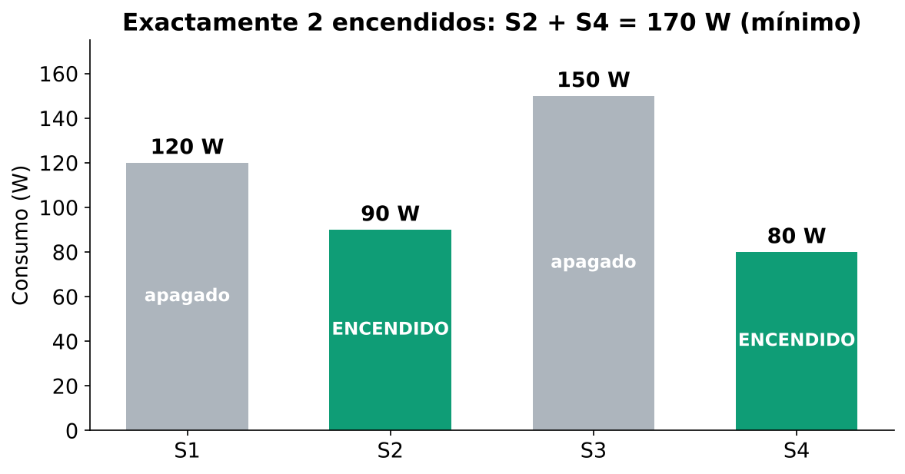
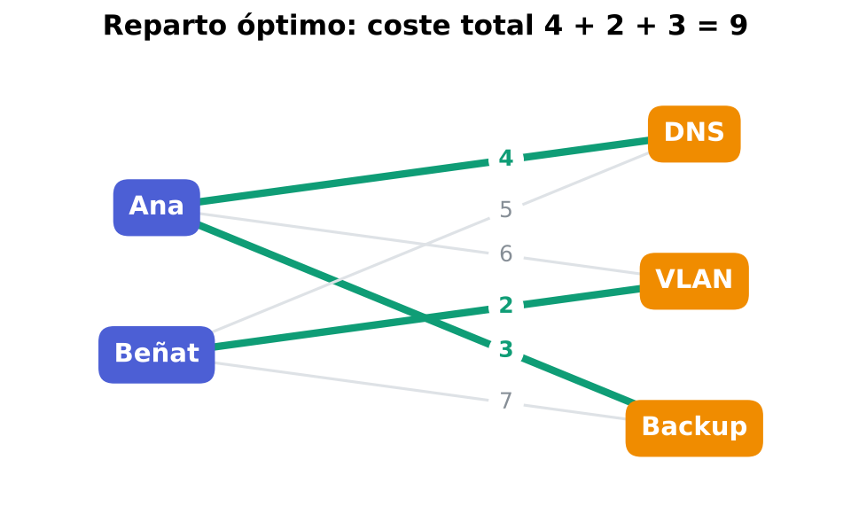
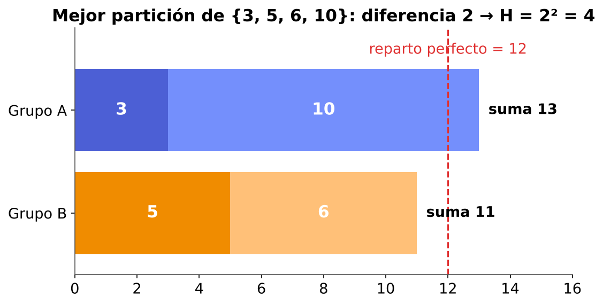
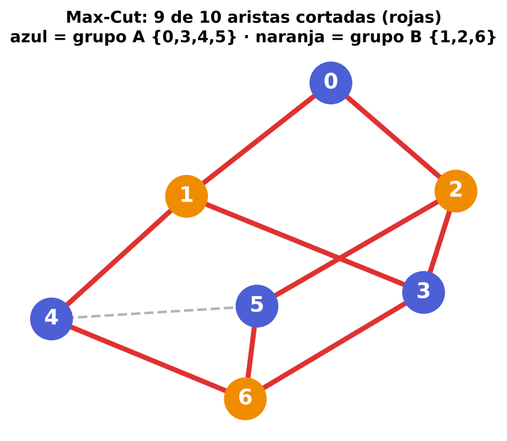

# 7 · Prácticas: preparar el entorno y resolver QUBO con dimod

> **Objetivo:** montar un entorno de programación Python con D-Wave Ocean, ejecutar un solver QUBO en local y resolver 5 ejercicios guiados y 1 de ampliación.
>
> **Material:** carpeta `descargas/` con `prueba_entorno.py` y `ejercicio1_*.py` … `ejercicio6_*.py` (código completo y comentado, reproducido también en este documento).

---

## Práctica 0 · Preparar el entorno de programación

Un único entorno para todo el módulo: **Python + dimod + dwave-samplers**. Todo es software libre y se instala con `pip`.

### Paso 1 · Instalar Python y el editor

1. **Python 3.11 o 3.12** → <https://www.python.org/downloads/>
   - En Windows marca ☑ *Add python.exe to PATH*.
   - En Ubuntu/Debian: `sudo apt install python3 python3-venv python3-pip`
2. **Visual Studio Code** → <https://code.visualstudio.com/> con las extensiones **Python** y **Jupyter** (de Microsoft).

### Paso 2 · Crear y activar un entorno virtual (venv)

Un entorno virtual aísla las librerías del proyecto, igual que un contenedor aísla una aplicación. Se crea una vez y se activa cada vez que se abre una terminal nueva.

### Paso 3 · Instalar librerías

- `dimod`: variables, modelo QUBO y fuerza bruta (`ExactSolver`).
- `dwave-samplers`: el recocido simulado rápido (`SimulatedAnnealingSampler`).
- `matplotlib` y `networkx`: gráficos de los ejercicios 4 y 7. `jupyter` e `ipykernel`: opcionales, para notebooks.
- Si más adelante se quiere acceder a la nube de D-Wave (Leap): `pip install dwave-ocean-sdk`.

### Tabla de comandos · Windows y Linux

Python es interpretado: **no se compila**, se ejecuta directamente con `python archivo.py`.

| Acción | Windows (PowerShell) | Linux / macOS (bash) |
|---|---|---|
| Comprobar Python | `python --version` | `python3 --version` |
| Instalar Python (si falta) | Descargar de python.org (marcar *Add to PATH*) | `sudo apt install python3 python3-venv python3-pip` |
| Crear carpeta del proyecto | `mkdir quantum-annealing; cd quantum-annealing` | `mkdir quantum-annealing && cd quantum-annealing` |
| Crear entorno virtual | `python -m venv qubo` | `python3 -m venv qubo` |
| **Activar** entorno | `.\qubo\Scripts\Activate.ps1` (CMD: `qubo\Scripts\activate.bat`) | `source qubo/bin/activate` |
| Si PowerShell bloquea la activación | `Set-ExecutionPolicy -Scope CurrentUser RemoteSigned` | — |
| Actualizar pip | `python -m pip install --upgrade pip` | `python -m pip install --upgrade pip` |
| **Instalar librerías** | `pip install dimod dwave-samplers matplotlib networkx` | `pip install dimod dwave-samplers matplotlib networkx` |
| Ver librerías instaladas | `pip list` | `pip list` |
| **Ejecutar un ejercicio** | `python ejercicio1_beneficio.py` | `python ejercicio1_beneficio.py` |
| Guardar la salida en un fichero | `python ejercicio1_beneficio.py > salida.txt` | `python ejercicio1_beneficio.py > salida.txt` |
| Abrir VS Code en la carpeta | `code .` | `code .` |
| Jupyter (opcional) | `pip install jupyter ipykernel` → `jupyter notebook` | igual |
| Desactivar entorno | `deactivate` | `deactivate` |

> Con el entorno activado el prompt muestra `(qubo)` delante. Dentro del entorno, `python` y `pip` son siempre los del entorno, en Windows y en Linux.

### Paso 4 · Prueba de funcionamiento

`prueba_entorno.py`:

```python
import sys, dimod
from dwave.samplers import SimulatedAnnealingSampler
print("Python", sys.version.split()[0], "| dimod", dimod.__version__)

a, b = dimod.Binary("A"), dimod.Binary("B")
H = -3*a - 2*b + 4*(a + b - 1)**2
print("H lineal:", dict(H.linear), "| cuadrático:", dict(H.quadratic), "| offset:", H.offset)
sol = SimulatedAnnealingSampler().sample(H, num_reads=4).first
print("Mejor:", sol.sample, "Energía:", sol.energy)
```

```bash
python prueba_entorno.py
```

Salida esperada:
```text
Python 3.12.x | dimod 0.12.x
H lineal: {'A': -7.0, 'B': -6.0} | cuadrático: {('B', 'A'): 8.0} | offset: 4.0
Mejor: {'A': 1, 'B': 0} Energía: -3.0
```

✅ **Entregable:** captura con el entorno activado, la versión de Python y la salida de `prueba_entorno.py`.

### Alternativa sin instalar nada · Google Colab
1. Abre <https://colab.research.google.com> y crea un cuaderno.
2. Primera celda: `!pip install dimod dwave-samplers`
3. Pega el código de cada ejercicio en una celda y ejecútalo.

---

## Método: 7 pasos para cualquier ejercicio

Todos los ejercicios siguen la **misma plantilla**, y el código está dividido en estos bloques con comentarios:

| Paso | Qué haces | En el código |
|:---:|---|---|
| 1 | **Datos** del enunciado | diccionarios y listas |
| 2 | **Variables**: una por cada decisión SÍ/NO | `dimod.Binary("nombre")` |
| 3 | **Objetivo**: coste, o −beneficio si hay que maximizar | sumas de `coef * x` |
| 4 | **Restricción → penalización** | `P * (... - k) ** 2` |
| 5 | **H** = objetivo + penalización | `H = objetivo + restriccion` |
| 6 | **Resolver** | `SimulatedAnnealingSampler().sample(H, num_reads=20, seed=42)` |
| 7 | **Interpretar y comprobar** (penalización = 0) | `resultado.first.sample`, `restriccion.energy(cfg)` |

| Ejercicio | Variables | Qué se practica |
|---|:---:|---|
| 1 · Elegir proyecto | 2 | Maximizar en negativo y "exactamente uno" |
| 2 · Servidores encendidos | 4 | Minimizar un coste y "exactamente K" |
| 3 · Reparto de tareas | 6 | Una restricción por cada tarea |
| 4 · Equilibrar VMs | 4 | Objetivo al cuadrado, sin restricciones |
| 5 · Max-Cut | 7 | Fórmula de "distintos" (XOR) en un grafo |
| 6 · Max-Cut N nodos *(ampliación)* | N | Qué pasa cuando el problema crece |

> En todos los ejercicios: **comprueba que la penalización de la mejor solución es 0**. Si no lo es, sube P.

---

## Ejercicio 1 · Elegir el proyecto con más beneficio (2 variables)

Solo podemos hacer **uno** de dos proyectos: A (beneficio 3) o B (beneficio 2).

| Elemento | Fórmula |
|---|---|
| Variables | x_A, x_B (1 = lo elijo) |
| Objetivo | −3·x_A − 2·x_B (maximizar → en negativo) |
| Restricción | 4·(x_A + x_B − 1)² (exactamente uno) |

**Resultado:** x_A = 1, x_B = 0 → **proyecto A**, energía −3, penalización 0.

<details><summary><b>Código completo</b> · <code>ejercicio1_beneficio.py</code></summary>

```python
"""
Ejercicio 1 · Elegir el proyecto con más beneficio            (2 variables)
============================================================================
Tenemos dos proyectos y solo podemos hacer UNO:
    Proyecto A → beneficio 3
    Proyecto B → beneficio 2
¿Cuál elegimos? (La respuesta es obvia: A. Sirve para aprender el método.)

Ejecutar:  python ejercicio1_beneficio.py
"""
import dimod
from dwave.samplers import SimulatedAnnealingSampler

# ── 1. DATOS ────────────────────────────────────────────────────────────
beneficio_A = 3
beneficio_B = 2
P = 4               # peso de la penalización: mayor que el beneficio máximo (3)

# ── 2. VARIABLES BINARIAS: una por cada decisión SÍ/NO ─────────────────
x_A = dimod.Binary("A")      # vale 1 si elijo el proyecto A, 0 si no
x_B = dimod.Binary("B")      # vale 1 si elijo el proyecto B, 0 si no

# ── 3. OBJETIVO ─────────────────────────────────────────────────────────
# Queremos MAXIMIZAR el beneficio, pero el solver siempre MINIMIZA.
# Truco: lo escribimos en negativo → más beneficio = energía más baja.
objetivo = -beneficio_A * x_A - beneficio_B * x_B

# ── 4. RESTRICCIÓN → PENALIZACIÓN ───────────────────────────────────────
# "Exactamente uno":  x_A + x_B = 1
# Al elevar al cuadrado vale 0 si se cumple y algo positivo si no.
restriccion = P * (x_A + x_B - 1) ** 2

# ── 5. HAMILTONIANO H = objetivo + penalización (esto es el QUBO) ───────
H = objetivo + restriccion
print("Modelo QUBO generado por dimod:")
print("  lineal    :", dict(H.linear))       # {'A': -7.0, 'B': -6.0}
print("  cuadrático:", dict(H.quadratic))    # {('B', 'A'): 8.0}
print("  constante :", H.offset)             # 4.0

# ── 6. RESOLVER ─────────────────────────────────────────────────────────
# Con solo 2 variables podemos ver TODAS las combinaciones (fuerza bruta):
print("\nTodas las combinaciones, de mejor a peor:")
print(dimod.ExactSolver().sample(H))

# Y con el recocido simulado (lo que usaríamos en problemas grandes):
sampler = SimulatedAnnealingSampler()
resultado = sampler.sample(H, num_reads=10, seed=42)   # 10 intentos

# ── 7. INTERPRETAR Y COMPROBAR ──────────────────────────────────────────
mejor = resultado.first        # la muestra con menor energía
cfg = mejor.sample             # diccionario, p. ej. {'A': 1, 'B': 0}

print("\nMejor solución:", cfg)
if cfg["A"] == 1:
    print("→ Se elige el proyecto A")
if cfg["B"] == 1:
    print("→ Se elige el proyecto B")
print("Energía:", mejor.energy, "(= −beneficio)")
print("Penalización:", restriccion.energy(cfg), "(0 = cumple la restricción)")
```
</details>

**Retos**
1. Cambia `P` a 1, 2 y 4. ¿Qué solución sale en cada caso? ¿Por qué?
2. Añade un proyecto C con beneficio 5. ¿Qué valor de P usarías?

<details><summary>Soluciones</summary>

1. P = 1 → elige los dos (H = −4), inválido. P = 2 → empate entre "solo A" y "los dos". P = 4 → solo A.
2. P = 6 (mayor que el beneficio máximo, 5). Sale C.
</details>

---

## Ejercicio 2 · Dejar encendidos 2 de 4 servidores (4 variables)

Por la noche bastan **2 servidores** encendidos. ¿Cuáles dejamos para consumir lo mínimo?

| Servidor | S1 | S2 | S3 | S4 |
|---|:---:|:---:|:---:|:---:|
| Consumo (W) | 120 | 90 | 150 | 80 |

| Elemento | Fórmula |
|---|---|
| Variables | x_S1 … x_S4 (1 = encendido) |
| Objetivo | 120·x_S1 + 90·x_S2 + 150·x_S3 + 80·x_S4 (ya es minimizar) |
| Restricción | 500·(x_S1 + x_S2 + x_S3 + x_S4 − 2)² |

> **¿Por qué P = 500?** Apagarlo todo cuesta 0 W. La multa por incumplir tiene que ser mayor que cualquier ahorro posible, así que usamos un P mayor que la suma de todos los consumos (440).



**Resultado:** **S2 + S4** encendidos → 170 W, penalización 0.

<details><summary><b>Código completo</b> · <code>ejercicio2_servidores.py</code></summary>

```python
"""
Ejercicio 2 · Dejar encendidos 2 de 4 servidores               (4 variables)
============================================================================
Por la noche solo hacen falta 2 servidores encendidos.
Queremos elegir EXACTAMENTE 2 con el menor consumo total.

    Servidor   Consumo (W)
    S1         120
    S2          90
    S3         150
    S4          80

Ejecutar:  python ejercicio2_servidores.py
"""
import dimod
from dwave.samplers import SimulatedAnnealingSampler

# ── 1. DATOS ────────────────────────────────────────────────────────────
consumo = {"S1": 120, "S2": 90, "S3": 150, "S4": 80}
K = 2               # cuántos servidores deben quedar encendidos
P = 500             # penalización: mayor que la suma de todos los consumos (440)

# ── 2. VARIABLES BINARIAS: una por servidor ─────────────────────────────
# x["S1"] = 1 → S1 encendido ; 0 → apagado
x = {s: dimod.Binary(s) for s in consumo}

# ── 3. OBJETIVO: consumo total de los encendidos ────────────────────────
# Ya es algo que queremos MINIMIZAR, así que no hace falta signo negativo.
objetivo = sum(consumo[s] * x[s] for s in consumo)

# ── 4. RESTRICCIÓN: exactamente K encendidos ────────────────────────────
#   x_S1 + x_S2 + x_S3 + x_S4 = 2   →   P · (suma − 2)²
encendidos = sum(x.values())
restriccion = P * (encendidos - K) ** 2

# ── 5. HAMILTONIANO ─────────────────────────────────────────────────────
H = objetivo + restriccion

# ── 6. RESOLVER ─────────────────────────────────────────────────────────
resultado = SimulatedAnnealingSampler().sample(H, num_reads=20, seed=42)

# ── 7. INTERPRETAR Y COMPROBAR ──────────────────────────────────────────
cfg = resultado.first.sample
elegidos = [s for s in consumo if cfg[s] == 1]
print("Servidores encendidos:", elegidos)
print("Consumo total:", objetivo.energy(cfg), "W")
print("Penalización:", restriccion.energy(cfg), "(0 = hay exactamente", K, "encendidos)")
```
</details>

**Retos**
1. Cambia `K = 3`. ¿Qué servidores quedan encendidos?
2. Cambia `P = 50`. ¿Se respeta la restricción?

<details><summary>Soluciones</summary>

1. S1 + S2 + S4 = 290 W (se apaga el que más consume, S3).
2. No: sale solo S4, porque 80 W + 50 de multa = 130 es menos que 170. P era demasiado pequeño.
</details>

---

## Ejercicio 3 · Repartir tareas entre dos técnicos (6 variables)

Cada tarea la hace **una** persona. Queremos el reparto con menos horas.

| Horas | Ana | Beñat |
|---|:---:|:---:|
| DNS | 4 | 5 |
| VLAN | 6 | 2 |
| Backup | 3 | 7 |

| Elemento | Fórmula |
|---|---|
| Variables | una por pareja: x(Ana,DNS), x(Beñat,DNS), … → 6 |
| Objetivo | Σ horas · x (ya es minimizar) |
| Restricción | por cada tarea t: 20·(x(Ana,t) + x(Beñat,t) − 1)² → **tres** penalizaciones que se suman |



**Resultado:** DNS → Ana, VLAN → Beñat, Backup → Ana · **9 horas**.

<details><summary><b>Código completo</b> · <code>ejercicio3_tareas.py</code></summary>

```python
"""
Ejercicio 3 · Repartir tareas entre dos técnicos               (6 variables)
============================================================================
Hay 3 tareas y 2 técnicos. Cada tarea la hace UNA persona.
Queremos el reparto con menos horas en total.

    Horas      Ana   Beñat
    DNS         4      5
    VLAN        6      2
    Backup      3      7

Ejecutar:  python ejercicio3_tareas.py
"""
import dimod
from dwave.samplers import SimulatedAnnealingSampler

# ── 1. DATOS ────────────────────────────────────────────────────────────
personas = ["Ana", "Beñat"]
tareas = ["DNS", "VLAN", "Backup"]
horas = {
    ("Ana", "DNS"): 4,   ("Ana", "VLAN"): 6,   ("Ana", "Backup"): 3,
    ("Beñat", "DNS"): 5, ("Beñat", "VLAN"): 2, ("Beñat", "Backup"): 7,
}
P = 20              # penalización: mayor que cualquier coste de la tabla (7)

# ── 2. VARIABLES BINARIAS: una por cada pareja (persona, tarea) ─────────
# x[("Ana", "DNS")] = 1  →  Ana hace la tarea DNS
x = {}
for p in personas:
    for t in tareas:
        x[(p, t)] = dimod.Binary(f"{p}-{t}")

# ── 3. OBJETIVO: horas totales del reparto ──────────────────────────────
objetivo = sum(horas[k] * x[k] for k in x)

# ── 4. RESTRICCIÓN: cada tarea la hace exactamente una persona ──────────
#   Para DNS:   x(Ana,DNS) + x(Beñat,DNS) = 1   → (… − 1)²
#   y lo mismo para VLAN y Backup. Sumamos las tres penalizaciones.
restriccion = 0
for t in tareas:
    personas_en_t = x[("Ana", t)] + x[("Beñat", t)]
    restriccion = restriccion + P * (personas_en_t - 1) ** 2

# ── 5. HAMILTONIANO ─────────────────────────────────────────────────────
H = objetivo + restriccion

# ── 6. RESOLVER ─────────────────────────────────────────────────────────
resultado = SimulatedAnnealingSampler().sample(H, num_reads=20, seed=42)

# ── 7. INTERPRETAR Y COMPROBAR ──────────────────────────────────────────
cfg = resultado.first.sample
for t in tareas:
    for p in personas:
        if cfg[f"{p}-{t}"] == 1:
            print(f"{t:7s} → {p}")
print("Horas totales:", objetivo.energy(cfg))
print("Penalización:", restriccion.energy(cfg), "(0 = cada tarea tiene una persona)")
```
</details>

**Retos**
1. Si Beñat tardase 9 h en VLAN, ¿cambia el reparto?
2. Añade a Carla con 3 h en todas las tareas (no olvides sumarla en la restricción).

<details><summary>Soluciones</summary>

1. Sí: todo para Ana, 4 + 6 + 3 = 13 h.
2. DNS pasa a Carla (3 &lt; 4). Total 8 h.
</details>

---

## Ejercicio 4 · Equilibrar máquinas virtuales entre dos hosts (4 variables, sin restricciones)

4 VMs con **3, 5, 6 y 10 GB** de RAM (24 GB). Queremos repartirlas entre los hosts A y B lo más igualado posible.

| Elemento | Fórmula |
|---|---|
| Variables | x_VM = 1 → host A · 0 → host B |
| RAM en A | 3·x₁ + 5·x₂ + 6·x₃ + 10·x₄ |
| Diferencia | RAM_A − RAM_B = 2·RAM_A − 24 |
| H | (2·RAM_A − 24)² → vale 0 si el reparto es perfecto |

> **Truco:** elevar al cuadrado convierte "lo más cerca de 0" en "lo más pequeño posible", que es justo lo que busca el solver.



**Resultado:** {3, 10} → 13 GB y {5, 6} → 11 GB. Diferencia 2, energía 4. No existe un reparto 12 / 12.

<details><summary><b>Código completo</b> · <code>ejercicio4_particion.py</code></summary>

```python
"""
Ejercicio 4 · Equilibrar máquinas virtuales entre dos hosts    (4 variables)
============================================================================
Tenemos 4 máquinas virtuales con esta RAM: 3, 5, 6 y 10 GB (total 24 GB).
Queremos repartirlas en dos hosts (A y B) con la RAM lo más igualada posible.
Lo ideal sería 12 GB en cada uno.

Este problema NO tiene restricciones: solo función objetivo.

Ejecutar:  python ejercicio4_particion.py
"""
import dimod
from dwave.samplers import SimulatedAnnealingSampler

# ── 1. DATOS ────────────────────────────────────────────────────────────
ram = {"VM1": 3, "VM2": 5, "VM3": 6, "VM4": 10}
total = sum(ram.values())                      # 24

# ── 2. VARIABLES BINARIAS: una por máquina ──────────────────────────────
# x["VM1"] = 1 → VM1 va al host A ;  0 → va al host B
x = {vm: dimod.Binary(vm) for vm in ram}

# ── 3. OBJETIVO ─────────────────────────────────────────────────────────
# RAM del host A = suma de las VMs con x = 1
ram_A = sum(ram[vm] * x[vm] for vm in ram)
# Diferencia entre hosts = ram_A − ram_B = ram_A − (total − ram_A) = 2·ram_A − total
# La elevamos al cuadrado: siempre ≥ 0 y vale 0 si el reparto es perfecto.
H = (2 * ram_A - total) ** 2

# ── 4. (sin restricciones) ──────────────────────────────────────────────
# ── 5. H ya está construido ─────────────────────────────────────────────

# ── 6. RESOLVER ─────────────────────────────────────────────────────────
resultado = SimulatedAnnealingSampler().sample(H, num_reads=20, seed=42)

# ── 7. INTERPRETAR ──────────────────────────────────────────────────────
cfg = resultado.first.sample
host_A = [vm for vm in ram if cfg[vm] == 1]
host_B = [vm for vm in ram if cfg[vm] == 0]
gb_A = sum(ram[vm] for vm in host_A)
print("Host A:", host_A, "→", gb_A, "GB")
print("Host B:", host_B, "→", total - gb_A, "GB")
print("Diferencia:", abs(2 * gb_A - total), "GB  | Energía:", resultado.first.energy)
```
</details>

**Retos**
1. Prueba con VMs de 4, 5, 6, 7 y 8 GB.
2. Prueba con VMs de 2, 4, 6, 8 y 12 GB.

<details><summary>Soluciones</summary>

1. {7, 8} y {4, 5, 6}: 15 / 15, energía 0.
2. {4, 12} y {2, 6, 8}: 16 / 16, energía 0.
</details>

---

## Ejercicio 5 · Max-Cut: dividir una red en dos grupos (7 variables, sin restricciones)

7 equipos y 10 conexiones: 0-1, 0-2, 1-3, 1-4, 2-3, 2-5, 3-6, 4-5, 4-6, 5-6. Queremos que el **máximo de conexiones** quede entre grupos distintos.

| Elemento | Fórmula |
|---|---|
| Variables | x_i = 0 → grupo A · 1 → grupo B |
| Arista cortada | x_i + x_j − 2·x_i·x_j (vale 1 si son distintos) |
| H | −(suma de aristas cortadas) |

| x_i | x_j | x_i + x_j − 2·x_i·x_j |
|:---:|:---:|:---:|
| 0 | 0 | 0 |
| 0 | 1 | **1** |
| 1 | 0 | **1** |
| 1 | 1 | 0 |



**Resultado:** A = {0, 3, 4, 5}, B = {1, 2, 6} → **9 de 10** aristas cortadas, energía −9.

<details><summary><b>Código completo</b> · <code>ejercicio5_maxcut.py</code></summary>

```python
"""
Ejercicio 5 · Max-Cut: dividir una red en dos grupos           (7 variables)
============================================================================
Una red de 7 equipos. Queremos separarlos en dos grupos (A y B) de forma
que el MÁXIMO número de conexiones (aristas) quede entre grupos distintos.
Este problema NO tiene restricciones: solo función objetivo.

Ejecutar:  python ejercicio5_maxcut.py
"""
import dimod
from dwave.samplers import SimulatedAnnealingSampler

# ── 1. DATOS: las conexiones de la red ──────────────────────────────────
aristas = [(0, 1), (0, 2), (1, 3), (1, 4), (2, 3),
           (2, 5), (3, 6), (4, 5), (4, 6), (5, 6)]
n = 7

# ── 2. VARIABLES BINARIAS: una por nodo ─────────────────────────────────
# x[i] = 0 → nodo i en el grupo A ;  x[i] = 1 → nodo i en el grupo B
x = [dimod.Binary(i) for i in range(n)]

# ── 3. OBJETIVO ─────────────────────────────────────────────────────────
# Una arista (i, j) está "cortada" si sus nodos están en grupos distintos.
#   x_i + x_j − 2·x_i·x_j  vale 1 si x_i ≠ x_j  y 0 si son iguales.
# Queremos MAXIMIZAR las cortadas → minimizamos su negativo.
H = 0
for i, j in aristas:
    cortada = x[i] + x[j] - 2 * x[i] * x[j]
    H = H - cortada

# ── 4-5. (sin restricciones: H ya está construido) ─────────────────────

# ── 6. RESOLVER ─────────────────────────────────────────────────────────
resultado = SimulatedAnnealingSampler().sample(H, num_reads=20, seed=42)

# ── 7. INTERPRETAR ──────────────────────────────────────────────────────
cfg = resultado.first.sample
grupo_A = [i for i in range(n) if cfg[i] == 0]
grupo_B = [i for i in range(n) if cfg[i] == 1]
cortadas = [(i, j) for i, j in aristas if cfg[i] != cfg[j]]
print("Grupo A:", grupo_A)
print("Grupo B:", grupo_B)
print("Aristas cortadas:", len(cortadas), "de", len(aristas))
print("Energía:", resultado.first.energy, "(= −aristas cortadas)")
```
</details>

**Retos**
1. ¿Por qué salen dos soluciones con la misma energía?
2. Quita la arista (4, 5). ¿Cuántas se pueden cortar ahora?

<details><summary>Soluciones</summary>

1. Intercambiar los grupos A y B da exactamente el mismo corte.
2. Las 9: sin esa arista la red se puede dividir sin dejar ninguna conexión dentro de un grupo.
</details>

---

## Ejercicio 6 · Max-Cut con N nodos (ampliación)

El mismo código del ejercicio 5, pero con una red aleatoria del tamaño que elijas. El script pide N, resuelve, compara con la fuerza bruta (si N ≤ 16) y dibuja la red. Necesita `pip install networkx matplotlib`.

```bash
python ejercicio6_maxcut_n_nodos.py
Número de nodos (3-60, Enter = 12): 20
```

Qué observar:
- Con 30 nodos hay más de **mil millones** de combinaciones (2³⁰), y aun así el solver encuentra cortes muy buenos en segundos.
- El tiempo crece **suave**: depende de nodos y aristas, no de 2ⁿ.
- ¿Cuántos de los 100 intentos (`num_reads`) llegan al mejor corte?

<details><summary><b>Código completo</b> · <code>ejercicio6_maxcut_n_nodos.py</code></summary>

```python
"""
Ejercicio 6 (ampliación) · Max-Cut con N nodos                 (N variables)
============================================================================
El mismo problema del ejercicio 5, pero con una red aleatoria del tamaño
que tú elijas. Sirve para ver qué pasa cuando el problema crece:
    · el número de combinaciones posibles es 2^N (crece muchísimo)
    · el modelo QUBO solo tiene N variables y una interacción por arista

Necesita:  pip install networkx matplotlib
Ejecutar:  python ejercicio6_maxcut_n_nodos.py
"""
import time
import dimod
import networkx as nx
import matplotlib.pyplot as plt
from dwave.samplers import SimulatedAnnealingSampler

# ── 1. DATOS: pedir N y crear una red aleatoria ─────────────────────────
texto = input("Número de nodos (3-60, Enter = 12): ").strip()
n = int(texto) if texto else 12
G = nx.erdos_renyi_graph(n, 0.5, seed=1)   # cada conexión existe con prob. 0,5
print(f"Red: {n} nodos, {G.number_of_edges()} aristas")
print(f"Combinaciones posibles: 2^{n} = {2**n:,}")

# ── 2. VARIABLES: una por nodo (0 → grupo A, 1 → grupo B) ───────────────
x = [dimod.Binary(i) for i in range(n)]

# ── 3. OBJETIVO: −(aristas cortadas), igual que en el ejercicio 5 ───────
H = 0
for i, j in G.edges():
    H = H - (x[i] + x[j] - 2 * x[i] * x[j])

# ── 6. RESOLVER (y medir el tiempo) ─────────────────────────────────────
inicio = time.time()
resultado = SimulatedAnnealingSampler().sample(H, num_reads=100, seed=42)
segundos = time.time() - inicio

# ── 7. INTERPRETAR ──────────────────────────────────────────────────────
mejor = resultado.first
cfg = mejor.sample
corte = int(-mejor.energy)
print(f"\nMejor corte encontrado: {corte} de {G.number_of_edges()} aristas")
print(f"Tiempo: {segundos:.2f} s para 100 intentos (num_reads)")

# ¿Cuántos de los 100 intentos llegaron a ese mismo corte?
energias = resultado.record.energy
veces = int(sum(resultado.record.num_occurrences[energias == mejor.energy]))
print(f"Intentos que llegaron al mejor corte: {veces} de 100")

# Con pocos nodos podemos comprobar el óptimo por fuerza bruta
if n <= 16:
    optimo = int(-dimod.ExactSolver().sample(H).first.energy)
    print(f"Óptimo real (fuerza bruta): {optimo}  →  ",
          "¡encontrado!" if optimo == corte else "no alcanzado")

# ── Dibujo: azul = grupo A, naranja = grupo B, rojo = arista cortada ────
colores = ["#4c5fd5" if cfg[i] == 0 else "#f08c00" for i in G.nodes()]
cortadas = [(i, j) for i, j in G.edges() if cfg[i] != cfg[j]]
pos = nx.spring_layout(G, seed=7)
nx.draw_networkx_edges(G, pos, edge_color="#cccccc")
nx.draw_networkx_edges(G, pos, edgelist=cortadas, edge_color="#e03131")
nx.draw_networkx_nodes(G, pos, node_color=colores)
nx.draw_networkx_labels(G, pos, font_color="white")
plt.title(f"Max-Cut {n} nodos: {corte}/{G.number_of_edges()} aristas cortadas")
plt.axis("off")
plt.show()
```
</details>

**Retos**
1. Prueba con 10, 16, 30 y 60 nodos. Anota tiempo, corte e intentos que aciertan.
2. Cambia `num_reads=100` por `10`. ¿Se sigue encontrando el mejor corte con 30 nodos?
3. Cambia la probabilidad 0,5 por 0,2. ¿Qué porcentaje de aristas se corta ahora?

---

## Simulador QUBO en la web

La web de apuntes incluye un **simulador QUBO en el navegador** con los ejercicios 1–5 precargados. Permite:
- cambiar los datos y el valor de **P**;
- ver el **polinomio H** expandido y la **matriz Q** que genera la librería;
- lanzar el **recocido simulado** con *runs* e *iteraciones* y ver la tabla de soluciones con su **frecuencia**;
- comparar con la **fuerza bruta** (todas las combinaciones).

Los presets son los ejercicios 1 a 5.

Úsalo para comprobar tus formulaciones antes de programarlas.

## Plantilla de entrega (por ejercicio)

1. **Problema**: una frase.
2. **Variables**: qué significa cada bit.
3. **Objetivo y penalizaciones**: fórmula y valor de P elegido (y por qué).
4. **Código** y **salida** (captura).
5. **Comprobación**: penalización de la mejor solución = 0 y lectura en lenguaje natural ("se elige A", "ruta A→B→C→D").
6. **Retos**: respuesta razonada.

---

## Rúbrica orientativa

| Criterio | Peso |
|---|:---:|
| Entorno instalado y funcionando (Práctica 0) | 20 % |
| Formulación correcta (variables, objetivo, penalizaciones) | 35 % |
| Código ejecuta y la solución es factible (penalización 0) | 25 % |
| Retos e interpretación del resultado | 20 % |
